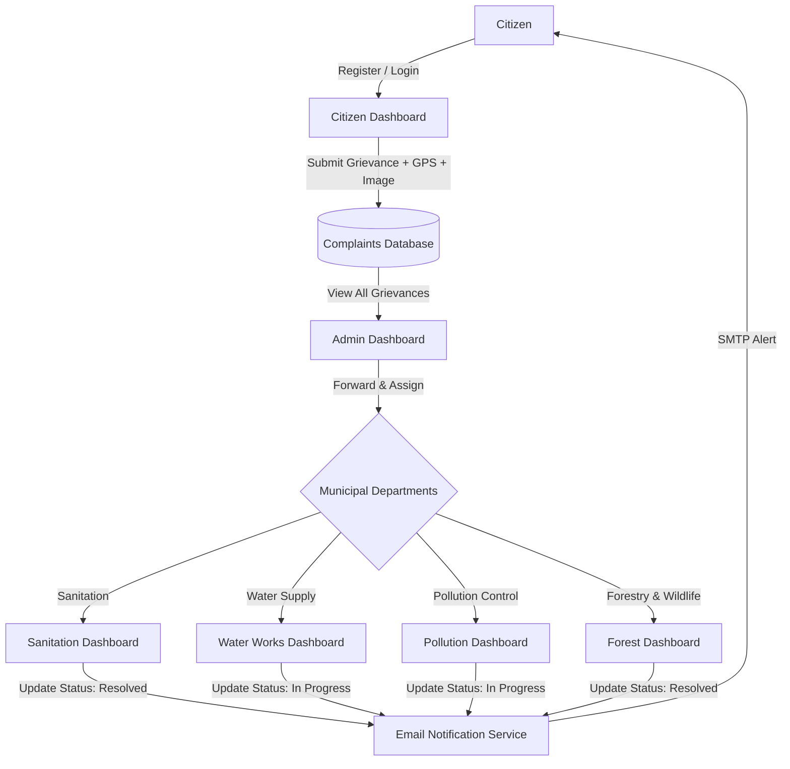

# 🌱 Green Alert (CSP B7)
### Community-Based Public Service Complaint Reporting and Management System

[](https://www.python.org/)
[](https://flask.palletsprojects.com/)
[](https://www.sqlalchemy.org/)
[](https://getbootstrap.com/)
[](#)

---

## 📌 Project Overview

**Green Alert (CSP B7)** is a web-based community civic portal designed to bridge the gap between citizens and municipal service departments. It provides an intuitive, accessible platform for residents to report local environmental, civic, and public health grievances—such as garbage accumulation, contaminated water supply, air and noise pollution, and hazardous trees or wildlife encroachment—directly to local authorities.

### Key Objectives
- **Empower Citizens:** Enable community members to lodge complaints with title, description, photographic evidence, and automatic browser-assisted GPS coordinates.
- **Centralized Administration:** Provide municipal administrators with an end-to-end command dashboard to triage, verify, and route complaints to the appropriate department.
- **Departmental Workflows:** Equip department officers (Sanitation, Water, Pollution, Forest) with specialized dashboards to track, update, and resolve civic complaints.
- **Automated Communication:** Dispatch real-time automated email notifications to citizens whenever their complaint resolution status updates.

---

## 🛠️ Technology Stack

| Layer | Technologies |
|---|---|
| **Backend Framework** | Python, Flask 3.1+ |
| **Database ORM** | Flask-SQLAlchemy 3.1+, SQLite (Modular & easily portable to PostgreSQL/MySQL) |
| **Authentication & Security** | Werkzeug (`generate_password_hash`, `check_password_hash` using scrypt), Flask Sessions |
| **Frontend UI** | HTML5, CSS3, Jinja2 Templates, Bootstrap 5, Vanilla JavaScript |
| **File Storage** | Local Secure File Uploads (`werkzeug.utils.secure_filename`) |
| **Notification Service** | Python Standard `smtplib`, `email.mime` (Gmail SMTP integration) |

---

## 👥 User Roles & Workflow



### 1. Citizen Portal
- Secure citizen registration with email validation and unique constraint checking.
- Session-based authentication with "Remember Me" session persistence.
- Interactive complaint submission form featuring:
  - Title and detailed narrative description.
  - Automatic geolocation lookup using HTML5 Geolocation API.
  - Optional photographic evidence upload (`.png`, `.jpg`, `.jpeg`).
- Real-time status cards: `Pending`, `In Progress`, `Resolved`, or `Forwarded to Department`.
- Ability to withdraw/delete resolved or duplicate complaints.

### 2. Central Administrator Portal
- Protected administrative login (`/admin`).
- Real-time overview of all submitted complaints across the jurisdiction.
- Department dispatch system: Assign complaints to specific departments with one click.
- Administrative moderation and complaint deletion controls.

### 3. Department Officer Portals
Dedicated login (`/department_login`) and dashboards for 4 core departments:
- 🧹 **Sanitation Department (`/department/sanitation`):** Garbage disposal, street cleaning, sewage clogs, drainage issues.
- 💧 **Water Works Department (`/department/water`):** Pipe leakages, contaminated water supply, low water pressure, broken mains.
- 🏭 **Pollution Control Department (`/department/pollution`):** Industrial effluent, vehicle emissions, illegal open burning, noise pollution.
- 🌳 **Forest & Wildlife Department (`/department/forest`):** Fallen or hazardous trees, wildlife encounters, deforestation, park maintenance.

---

## 📂 Project Structure

```
Green-Alert/
│
├── app.py                         # Core Flask application, routing, models, and business logic
├── requirements.txt               # Python package dependencies
├── .env.example                   # Template for environment variables and secrets
├── .gitignore                     # Git ignore rules for database, caches, and secrets
├── README.md                      # Comprehensive project documentation
│
├── static/
│   ├── images/                    # UI branding, hero illustrations, and theme banners
│   └── uploads/                   # Folder for user-uploaded complaint attachments (.gitkeep preserved)
│
└── templates/                     # Jinja2 presentation templates
    ├── index.html                 # Public landing page with portal navigation
    ├── register.html              # Citizen registration form with validation feedback
    ├── login.html                 # Citizen login portal
    ├── dashboard.html             # Citizen dashboard for complaint submission and tracking
    ├── admin_login.html           # Administrator login portal
    ├── admin_dashboard.html       # Administrative triage and department assignment console
    ├── department_login.html      # Department officer authentication portal
    ├── sanitation.html            # Sanitation department management dashboard
    ├── water.html                 # Water works department management dashboard
    ├── pollution.html             # Pollution control department management dashboard
    └── forest.html                # Forestry and wildlife department management dashboard
```

---

## 🚀 Getting Started

### 1. Prerequisites
Ensure you have Python 3.10 or higher installed:
```bash
python --version
```

### 2. Clone the Repository
```bash
git clone https://github.com/someshkumar58/Green-Alert.git
cd Green-Alert
```

### 3. Create and Activate a Virtual Environment
```bash
# Windows (PowerShell)
python -m venv venv
.\venv\Scripts\Activate.ps1

# Linux / macOS
python3 -m venv venv
source venv/bin/activate
```

### 4. Install Dependencies
```bash
pip install -r requirements.txt
```

### 5. Configure Environment Variables
Copy the example environment template to create your local `.env`:
```bash
# Windows
copy .env.example .env

# Linux / macOS
cp .env.example .env
```
Open `.env` and configure:
- `SECRET_KEY`: A secure random string for Flask session encryption.
- `EMAIL_SENDER` & `EMAIL_PASSWORD`: Optional Gmail account and App Password for real-time dispatch alerts.

### 6. Initialize Database & Run Application
```bash
python app.py
```
Open your web browser and navigate to:
**`http://127.0.0.1:5000/`**

---

## 🔑 Default Credentials (Development Setup)

| Role | Portal URL | Default Email | Default Password |
|---|---|---|---|
| **Administrator** | `/admin` | `admin@example.com` | `adminpass` |
| **Sanitation Officer** | `/department_login` | `sanitation@green.com` | `san123` |
| **Water Works Officer** | `/department_login` | `water@green.com` | `wat123` |
| **Pollution Officer** | `/department_login` | `pollution@green.com` | `pol123` |
| **Forest Officer** | `/department_login` | `forest@green.com` | `for123` |
| **Citizen** | `/register` | *Register a new account* | *User defined* |

*(Note: In production environments, override these credentials via `.env` environment variables).*

---

## 🔒 Security & Privacy Notice
- **Database Exclusion:** Production and test databases (`site.db`, `site_backup.db`) containing personal citizen information are strictly excluded from source control via `.gitignore`.
- **Uploads Sanitation:** The `static/uploads/` directory tracks its folder structure via `.gitkeep`, while user-uploaded media is excluded to protect citizen privacy.
- **Credential Segregation:** Plaintext passwords, SMTP secrets, and session keys are loaded dynamically through environment variables and never committed to version control.
- **Password Protection:** Citizen passwords are cryptographically salted and hashed using modern `scrypt` hashing via Werkzeug before persisting to storage.

---

## 📄 License
This repository is developed as an academic and community service project (CSP B7). All rights reserved.

