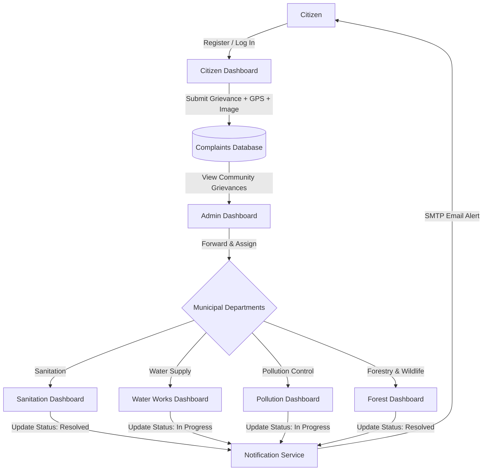

# Green Alert – Community Complaint Management System

[](https://www.python.org/)
[](https://flask.palletsprojects.com/)
[](https://www.sqlalchemy.org/)
[](https://getbootstrap.com/)
[](#license)

**Green Alert** is a web-based community complaint reporting and management platform that allows citizens to report environmental and public service issues and helps administrators and department officers manage and resolve complaints.

---

## 📌 Project Overview

Urban and rural localities often struggle with efficient public grievance reporting. Traditional complaint channels are frequently slow, opaque, and fragmented across disparate municipal offices. 

**Green Alert** centralizes community civic oversight into an accessible digital hub. Citizens can report local concerns—such as unattended garbage piles, drinking water pipe leakages, industrial emissions, and hazardous trees or wildlife encounters—directly to the portal. Municipal authorities review and route each report to dedicated departmental officers, who investigate, update status milestones, and notify residents in real time.

---

## ✨ Key Features

- **📍 Geolocation-Enabled Grievance Lodging:** Citizens can file reports with narrative descriptions, photographic attachments, and automatic GPS coordinates captured via browser geolocation.
- **🛡️ Secure User Authentication:** Salted cryptographic password hashing via `scrypt` (Werkzeug), persistent session state management, and strict access controls.
- **🏛️ Central Administrative Dispatch Console:** Municipal admins gain a comprehensive overview of all citizen grievances across the locality, with single-click forwarding to specialized departments.
- **🏢 Specialized Department Dashboards:** Dedicated command portals for Sanitation, Water Works, Pollution Control, and Forest & Wildlife officers to triage, track, and update complaint statuses.
- **📧 Automated Email Notifications:** Automated Gmail SMTP service keeps citizens informed by dispatching real-time email alerts whenever their complaint status changes.
- **📊 Real-Time Status Tracking:** Transparent status indicators (`Pending`, `In Progress`, `Resolved`, `Forwarded to Department`) visible to citizens on their personal dashboard.
- **🗑️ Grievance Lifecycle Management:** Citizens retain the ability to withdraw their complaints once resolved or filed in error.

---

## 🛠️ Technology Stack

| Layer | Technologies & Tools |
|---|---|
| **Backend Framework** | Python 3.10+, Flask 3.1+ |
| **Database & ORM** | SQLite (development/embedded), Flask-SQLAlchemy 3.1+ |
| **Authentication & Cryptography** | Werkzeug (`generate_password_hash`, `check_password_hash`), Flask Sessions |
| **Frontend UI** | HTML5, CSS3, Jinja2 Template Engine, Bootstrap 5.3, Vanilla JavaScript |
| **File Storage** | Local Secure File Uploads (`werkzeug.utils.secure_filename`) |
| **Notification Engine** | Python `smtplib`, `email.mime` (Gmail SMTP service) |
| **Environment Management** | Python `os.environ` configuration with `.env` file support |

---

## 🔄 System Workflow



---

## 👥 User Roles & Portals

### 1. Citizen Portal (`/register`, `/login`, `/dashboard`)
- **Account Registration & Login:** Create an account with name, email, and password.
- **Submit Grievance:** File new complaints with title, description, GPS location, and optional photo attachment.
- **Status Monitoring:** View all submitted complaints with color-coded status badges.
- **Manage Submissions:** Delete resolved or obsolete complaints.

### 2. Central Administrator Portal (`/admin`, `/admin/dashboard`)
- **Global Overview:** Monitor all complaints submitted across the jurisdiction.
- **Department Routing:** Assign and forward complaints to the appropriate specialized department.
- **Administrative Moderation:** Remove duplicate or inappropriate complaint entries.

### 3. Department Officer Portals (`/department_login`)
Dedicated dashboards tailored to municipal responsibilities:
- 🧹 **Sanitation Department (`/department/sanitation`):** Garbage disposal, street cleaning, sewage overflows, illegal dumping.
- 💧 **Water Works Department (`/department/water`):** Pipe leaks, contaminated water supply, low water pressure, broken mains.
- 🏭 **Pollution Control Department (`/department/pollution`):** Air pollution, industrial emissions, noise violations, chemical dumping.
- 🌳 **Forest & Wildlife Department (`/department/forest`):** Hazardous/fallen trees, wildlife encroachment, park maintenance, deforestation.

Officers can review assigned complaints and transition their status (`Pending` → `In Progress` → `Resolved`), triggering automatic email updates to the reporting citizen.

---

## 🗄️ Database Overview

The application utilizes SQLAlchemy ORM with a relational database model (`site.db`):

### 1. `User` Model
| Column | Type | Constraints | Description |
|---|---|---|---|
| `id` | Integer | Primary Key, Auto-increment | Unique user identifier |
| `name` | String(150) | Not Null | Citizen full name |
| `email` | String(150) | Unique, Not Null | Citizen email address for login and alerts |
| `password` | String(200) | Not Null | `scrypt`-hashed cryptographic password digest |

### 2. `Complaint` Model
| Column | Type | Constraints | Description |
|---|---|---|---|
| `id` | Integer | Primary Key, Auto-increment | Unique complaint identifier |
| `user_id` | Integer | Foreign Key (`user.id`) | Reference to submitting citizen |
| `title` | String(200) | Not Null | Complaint title / headline |
| `description` | Text | Not Null | Detailed narrative of the grievance |
| `location` | String(200) | Not Null | GPS latitude and longitude coordinates |
| `image` | String(300) | Nullable | Filename of uploaded photographic evidence |
| `status` | String(100) | Default: `'Pending'` | Current state (`Pending`, `In Progress`, `Resolved`) |
| `department` | String(100) | Default: `''` | Assigned municipal department |

---

## 📂 Project Structure

```
Green-Alert/
│
├── app.py                         # Application entry point, routes, models, and notification logic
├── requirements.txt               # Production Python dependencies
├── .env.example                   # Environment configuration template
├── .gitignore                     # Git exclusion rules for databases, media, and secrets
├── README.md                      # Comprehensive project documentation
│
├── static/
│   ├── images/                    # UI branding, illustrations, and thematic assets
│   └── uploads/                   # Storage for user-submitted evidence (.gitkeep preserved)
│
└── templates/                     # Jinja2 presentation templates
    ├── index.html                 # Landing page with service overview and portal navigation
    ├── register.html              # Citizen registration portal
    ├── login.html                 # Citizen login portal
    ├── dashboard.html             # Citizen dashboard for complaint lodging and tracking
    ├── admin_login.html           # Administrator login portal
    ├── admin_dashboard.html       # Central administrative management console
    ├── department_login.html      # Municipal department login portal
    ├── sanitation.html            # Sanitation department management dashboard
    ├── water.html                 # Water works department management dashboard
    ├── pollution.html             # Pollution control department management dashboard
    └── forest.html                # Forestry and wildlife department management dashboard
```

---

## 🚀 Installation & Setup

### 1. Prerequisites
- Python 3.10 or higher installed:
  ```bash
  python --version
  ```
- Git installed on your local machine:
  ```bash
  git --version
  ```

### 2. Clone the Repository
```bash
git clone https://github.com/someshkumar58/Green-Alert.git
cd Green-Alert
```

### 3. Create and Activate a Virtual Environment
```bash
# Windows (PowerShell)
python -m venv venv
.\venv\Scripts\Activate.ps1

# Linux / macOS
python3 -m venv venv
source venv/bin/activate
```

### 4. Install Dependencies
```bash
pip install -r requirements.txt
```

### 5. Environment Configuration
Copy `.env.example` to create your local `.env`:
```bash
# Windows
copy .env.example .env

# Linux / macOS
cp .env.example .env
```

Configure your local settings in `.env`:
```env
# Flask Application Settings
SECRET_KEY=your_secret_key_change_in_production
DATABASE_URL=sqlite:///site.db
UPLOAD_FOLDER=static/uploads

# Administrator Credentials
ADMIN_EMAIL=admin@example.com
ADMIN_PASSWORD=adminpass

# Department Credentials
DEPT_SANITATION_EMAIL=sanitation@green.com
DEPT_SANITATION_PASSWORD=san123
DEPT_WATER_EMAIL=water@green.com
DEPT_WATER_PASSWORD=wat123
DEPT_POLLUTION_EMAIL=pollution@green.com
DEPT_POLLUTION_PASSWORD=pol123
DEPT_FOREST_EMAIL=forest@green.com
DEPT_FOREST_PASSWORD=for123

# Email Notification Service (Gmail SMTP via App Password)
EMAIL_SENDER=your_email@gmail.com
EMAIL_PASSWORD=your_gmail_app_password
```

### 6. Run the Application
```bash
python app.py
```
Open your web browser and navigate to:
**`http://127.0.0.1:5000/`**

---

## 🔑 Default Credentials (Development Mode)

| Role | Portal URL | Default Email | Default Password |
|---|---|---|---|
| **Administrator** | `/admin` | `admin@example.com` | `adminpass` |
| **Sanitation Officer** | `/department_login` | `sanitation@green.com` | `san123` |
| **Water Works Officer** | `/department_login` | `water@green.com` | `wat123` |
| **Pollution Officer** | `/department_login` | `pollution@green.com` | `pol123` |
| **Forest Officer** | `/department_login` | `forest@green.com` | `for123` |
| **Citizen** | `/register` | *Register a new account* | *User defined* |

*(Note: In production deployments, override these defaults by configuring the corresponding environment variables in your `.env` file).*

---

## 🔮 Future Enhancements

- **🗺️ Interactive GIS Heatmaps:** Integrated Leaflet / Mapbox visualization showing grievance density clusters across neighborhoods.
- **📱 Native Mobile Application:** Cross-platform React Native / Flutter companion app with push notifications and instant camera capture.
- **👍 Community Upvoting & Validation:** Enable fellow residents to upvote and comment on existing complaints to prevent duplicates and prioritize critical civic issues.
- **⏱️ SLA & Escalation Tracking:** Automated service level agreement timers that escalate unattended grievances to senior municipal supervisors.
- **📲 SMS / WhatsApp Notifications:** Multi-channel alerting integration via Twilio or WhatsApp Business API.

---

## 📄 License

This project is licensed under the [MIT License](LICENSE) — see the LICENSE file for details.
